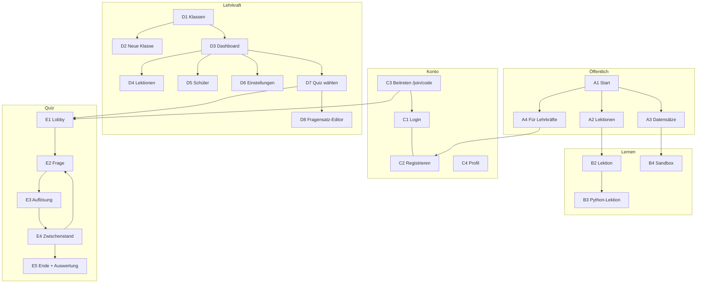

# SbSQLTT: Designer-Spezifikation (Screen für Screen)

Stand: 2026-10-17 · Basis: [`SPEC.md`](./SPEC.md)

Dieses Dokument beschreibt **jeden Screen**: Zweck, Inhalte, Aktionen (was passiert beim Klick) und Zustände.
Es macht **keine** Vorgaben zu Farben, Typo oder Stil. Das ist Aufgabe des Designs.

---

## 0. Grundregeln für alle Screens

- **Eine Hauptaktion pro Screen.** Sie ist klar hervorgehoben, alles andere ist sekundär.
- **Zielgruppe:** Klasse 10 bis 13 und Lehrkräfte. Sachlich, erwachsen, einladend, kein Kinder-Look.
- **Schriftgröße:** wie aktuell, nicht vergrößern.
- **Theme:** Hell und Dunkel.
- **Sprachen:** Deutsch (Standard) und Englisch. Texte können auf Englisch ca. 30 % kürzer oder länger sein.
- **Breakpoints:** Mobil (ab 360 px), Tablet (768 px), Desktop (ab 1280 px), **Beamer** (1920 × 1080, nur Quiz und QR).
- **Zustände:** Für jeden Screen bitte gestalten: **Leer · Lädt · Fehler · Erfolg** (wo angegeben).
- **Toasts:** kurze Bestätigungen unten (z. B. „Gespeichert“), verschwinden nach ca. 3 s.
- **Barrierefreiheit:** sichtbarer Fokus-Ring, Kontrast mindestens AA, alles per Tastatur bedienbar.

### Navigation (global)

| Bereich | Kopfzeile enthält |
|---|---|
| Öffentlich / Lernen | Logo → Startseite · „Lernen“ · „Datensätze“ · „Für Lehrkräfte“ · Theme-Schalter · Sprache · **Anmelden** bzw. Avatar-Menü |
| Lehrerbereich | Logo → Klassenübersicht · Klassen-Auswahl · Avatar-Menü (Profil, Zum Lernbereich, Abmelden) |
| Lektion | **reduziert:** Zurück zur Übersicht · Lektionstitel · Fortschritt (Schritt x/y) · Avatar |
| Quiz (Beamer + Schüler) | **keine** Navigation, Vollbild |

Avatar-Menü (Schüler): Meine Klassen · Klasse beitreten · Profil · Abmelden.
Mobil: Navigation als Menü-Button (Burger), Hauptaktion bleibt sichtbar.

---

## A. Öffentlich

### A1 Startseite (`/`)
**Zweck:** In 5 Sekunden verstehen, was das ist, und sofort loslegen.
- Inhalte:
  1. Hero: Ein-Satz-Versprechen („SQL lernen an echten Daten, direkt im Browser“), Untertitel, **Hauptaktion „Jetzt lernen“**, sekundär „Für Lehrkräfte“.
  2. Live-Mini-Editor **oder** Vorschaubild einer Lektion.
  3. Drei Vorteile: kein Login nötig · läuft im Browser · Datenbank für Python herunterladen.
  4. Lernpfad-Vorschau: SQL-Grundlagen → Eigene DB bauen → Python & Datenanalyse.
  5. Abschnitt für Lehrkräfte: Klassen, Fortschritt, Live-Quiz → „Mehr erfahren“.
  6. Footer: Impressum, Datenschutz, GitHub, Sprache.
- Aktionen:
  - „Jetzt lernen“ → **A2** (ist der Nutzer in einer Klasse mit Fokus-Lektion → direkt **B2** dieser Lektion).
  - „Für Lehrkräfte“ → **A4**.
  - „Anmelden“ → **C1**.

### A2 Lektionsübersicht (`/learn`)
**Zweck:** Lektion auswählen.
- Inhalte:
  - Optional oben: **Fokus-Banner** „Deine Klasse *10b* arbeitet gerade an: *JOIN*“ + Button „Öffnen“.
  - Optional: Hinweis für Gäste „Fortschritt wird nur in diesem Browser gespeichert. Anmelden, um ihn zu sichern.“
  - Tracks als Abschnitte: **1 SQL-Grundlagen** (Lektionen 1–8), **2 Eigene Datenbank** (9), **3 Python & Daten** (10 + Projekt). Später: Advanced.
  - Je Lektion: Nummer, Titel, Dauer (min), Status (offen · begonnen · fertig), ggf. gesperrt (von Lehrkraft nicht freigeschaltet, mit Schloss + Tooltip „Von deiner Lehrkraft noch nicht freigeschaltet“).
  - Fortschritt je Track (z. B. 3/8).
- Aktionen:
  - Klick auf Lektion → **B2** beim letzten offenen Schritt.
  - Klick auf gesperrte Lektion → nichts, Tooltip.
- Zustände: **Erstbesuch** (alles offen, Hinweis „Starte mit Lektion 1“) · **Fortgeschritten** (nächste Lektion hervorgehoben: „Weiter mit …“).

### A3 Datensätze (`/datasets`)
**Zweck:** Datenbanken herunterladen und lokal (Python) nutzen.
- Inhalte: Liste der Datensätze als Karten. Je Karte: Name, 1-Satz-Beschreibung, Größe, Tabellen-Anzahl, Tags (z. B. „Zeitreihe“).
- Detail (aufklappen oder eigene Seite `/datasets/[id]`):
  - Beschreibung und Story („Wozu ist dieser Datensatz?“).
  - **Schema-Ansicht:** Tabellen, Spalten, Typen, Schlüssel (ER-Diagramm optional).
  - Vorschau: erste 10 Zeilen je Tabelle.
  - Downloads: **`.db` (SQLite)** · `.csv` (ZIP).
  - Python-Snippet mit Button **„Kopieren“** (Download per `requests`, Öffnen mit `sqlite3`/`pandas`).
  - Button „Im Browser ausprobieren“ → Sandbox **B4** mit diesem Datensatz.
- Aktionen: Download startet Datei · Kopieren → Toast „Kopiert“.

### A4 Für Lehrkräfte (`/fuer-lehrkraefte`)
**Zweck:** Lehrkräfte überzeugen und zum Konto führen.
- Inhalte: Nutzen in 3 Punkten (Klassen & Fortschritt · Live-Quiz · Datenschutz/Self-Hosting), Lehrplan-Bezug, Ablauf einer Unterrichtsstunde (Quiz → Lektion → Hausaufgabe), FAQ, **Hauptaktion „Lehrer-Konto erstellen“**.
- Aktionen: „Lehrer-Konto erstellen“ → **C2** (Rolle Lehrkraft vorausgewählt).
- Hinweis: aktuelle Seite sagt „Punktesystem bewusst nicht geplant“. Das Quiz hat Punkte/Rangliste, Text muss angepasst werden (Punkte nur im Quiz, keine Noten).

### A5 Impressum, Datenschutz, Docs
Reine Textseiten, gut lesbares Layout, Inhaltsverzeichnis links (Desktop).

---

## B. Lernen

### B2 Lektion (`/learn/[track]/[lesson]`)
**Zweck:** Ein Thema verstehen und üben. Herzstück der App.
- Aufbau: Schritte nacheinander, Fortschritt oben (Punkte/Balken, Schritt x/y). Schritt-Typen:
  1. **Erklärung:** Text, ggf. Code-Beispiel mit Button „Ausprobieren“ (übernimmt Code in Editor).
  2. **Beispiel:** Abfrage + Ergebnis, ausführbar.
  3. **Übung:** siehe unten.
  4. **Zusammenfassung:** Kernpunkte, „Wozu braucht man das in echt?“, Button „Nächste Lektion“.
- **Übungs-Layout:**
  - Desktop: links Aufgabe + Schema, rechts Editor oben + Ergebnis unten. Mobil: untereinander (Aufgabe → Editor → Ergebnis), Schema als ausklappbares Panel.
  - Aufgabe: Text, ggf. erwartete Spalten.
  - **Schema-Panel:** Tabellen mit Spalten und Typen. Klick auf Tabellen- oder Spaltennamen fügt ihn in den Editor ein.
  - Editor: SQL-Highlighting, Autovervollständigung, Zeilennummern, vorausgefüllter Startcode.
  - Buttons: **„Ausführen“** (Hauptaktion, Strg/⌘+Enter) · „Zurücksetzen“ (Startcode wiederherstellen, mit Rückfrage) · „Tipp“ (erst nach 3 Fehlversuchen) · „Lösung zeigen“ (erst nach Tipp, mit Rückfrage „Lösung wirklich anzeigen?“).
  - Ergebnis-Tabelle: Spaltenköpfe, Zeilenanzahl, scrollbar, bei > 100 Zeilen Hinweis „Erste 100 von N Zeilen“.
- **Zustände der Übung:**

  | Zustand | Anzeige |
  |---|---|
  | Neu | Startcode, Ergebnisbereich leer: „Führe deine Abfrage aus, um das Ergebnis zu sehen.“ |
  | Läuft | kurzer Lade-Indikator im Ergebnisbereich |
  | SQL-Fehler | Fehlerbox mit verständlicher Meldung (DE) + Original-Fehler klein, betroffene Zeile im Editor markiert |
  | Läuft, aber falsch | Ergebnis wird angezeigt + Hinweis „Noch nicht richtig“ mit konkretem Unterschied (z. B. „3 Zeilen zu viel“, „Spalte *year* fehlt“) |
  | Richtig | Erfolgsmeldung, Ergebnis bleibt sichtbar, Hauptaktion wechselt zu **„Weiter“** |
  | Hängt fest | ab 3 Fehlversuchen erscheint „Tipp“, Lehrkraft sieht Status „hängt fest“ |

- Kopfleiste Lektion: Zurück (→ A2), Titel, Fortschritt, **„Datenbank herunterladen“** (Icon-Button, `.db` des aktuellen Lektions-Datensatzes).
- Navigation zwischen Schritten: „Zurück“ / „Weiter“ unten. „Weiter“ bei Übung erst nach Lösung aktiv (oder „Überspringen“ als Textlink).
- Ende der Lektion: Abschluss-Screen „Lektion geschafft“ mit Zusammenfassung, Buttons „Nächste Lektion“ (Haupt) und „Zur Übersicht“.
- Gäste: nach erster gelöster Übung dezenter Hinweis „Melde dich an, um deinen Fortschritt zu sichern“ (einmalig, schließbar).

### B3 Lektion 10: Python-Lektion (Sonderfall)
Keine Ausführung im Browser. Schritte zeigen:
- Download-Button `.db`, Python-Codeblöcke mit **„Kopieren“**, erwartete Ausgabe als Bild/Text.
- Checkliste („Python installiert?“, „Datei heruntergeladen?“, „Skript läuft?“), die Schüler selbst abhaken.
- Hilfe-Box „Python installieren“ (Windows / macOS) aufklappbar.

### B4 Sandbox (`/sandbox`, optional für Demo)
Freies SQL ohne Aufgabe: Datensatz-Auswahl oben, Schema links, Editor + Ergebnis rechts, Download-Button.
Zusätzlich: „Neue leere Datenbank“ (für DDL-Experimente), „Zurücksetzen“.

---

## C. Konto

### C1 Anmelden (`/login`)
- Felder: E-Mail **oder** Benutzername, Passwort. Link „Passwort vergessen?“, Link „Konto erstellen“.
- Hauptaktion: „Anmelden“.
- Fehler: „E-Mail/Benutzername oder Passwort falsch“ (nicht verraten, welches).
- Nach Erfolg: Schüler → A2 (bzw. zurück zur vorherigen Seite oder zum Quiz) · Lehrkraft → **D1**.
- Wenn über QR/Beitrittslink gekommen: Hinweis oben „Du trittst der Klasse *10b* bei“.

### C2 Konto erstellen (`/register`)
- Auswahl oben: **Ich bin Schüler:in** / **Ich bin Lehrkraft**.
- Schüler: Benutzername, Anzeigename, Passwort (2×). E-Mail optional (nur für Passwort-Reset). Optional Klassencode.
- Lehrkraft: Name, E-Mail, Passwort (2×), Schule (optional), Bestätigung Datenschutz.
- Passwort-Regeln live anzeigen.
- Nach Erfolg: Schüler mit Klassencode → Klasse beigetreten, Toast → A2 · Lehrkraft → D1 (leerer Zustand).

### C3 Klasse beitreten (`/join` und `/join/[code]`)
- Über QR-Code kommt man direkt auf `/join/ABC123`.
- Ablauf:
  1. Nicht angemeldet → C1/C2 mit Hinweis „Du trittst der Klasse *10b* bei“.
  2. Angemeldet → Bestätigung „Klasse *10b* (Fr. Müller) beitreten?“ → **„Beitreten“**.
  3. Erfolg → „Du bist jetzt in *10b*. Melde dich am PC mit demselben Konto an.“ → Button „Weiter“ (→ A2 oder laufendes Quiz).
- Ohne Code: Eingabefeld für 6-stelligen Code.
- Fehler: „Code ungültig oder abgelaufen“ · „Du bist bereits in dieser Klasse“.

### C4 Profil (`/profile`)
- Anzeigename, Benutzername, E-Mail, Passwort ändern, Theme, Sprache.
- Schüler: Liste „Meine Klassen“ mit „Verlassen“ (Rückfrage).
- Konto löschen (Rückfrage mit Eingabe des Benutzernamens).

### C5 Passwort vergessen
E-Mail eingeben → „Falls ein Konto existiert, haben wir dir eine E-Mail geschickt.“ Schüler ohne E-Mail: Hinweis „Bitte deine Lehrkraft, dein Passwort zurückzusetzen.“

---

## D. Lehrerbereich

### D1 Klassenübersicht (`/teach`)
**Zweck:** Alle Klassen auf einen Blick.
- Inhalte: Karten je Klasse: Name, Schuljahr, Anzahl Schüler, **aktuelle Fokus-Lektion**, Anzahl „hängt fest“ (rot hervorgehoben, wenn > 0), letzte Aktivität.
- Hauptaktion: **„Neue Klasse“**.
- Aktionen: Klick auf Karte → D3. Menü an Karte: Umbenennen, Archivieren.
- Leer: Illustration + „Noch keine Klasse. Lege deine erste Klasse an.“ + Button „Neue Klasse“.
- Filter oben: Aktiv / Archiviert.

### D2 Neue Klasse (`/teach/new`)
- Felder: Name (z. B. „Info 10b“), Schuljahr (vorausgefüllt), optional Start-Lektionen (Voreinstellung: Track 1 freigeschaltet).
- Hauptaktion: „Klasse erstellen“.
- Danach: Erfolgs-Screen mit **Beitrittscode + QR-Code** groß, Buttons „Vollbild (Beamer)“, „Link kopieren“, „Zur Klasse“.

### D3 Klassen-Dashboard (`/teach/[class]`)
**Zweck:** Sehen, wo die Klasse steht und wer Hilfe braucht.
- Kopf: Klassenname, Beitrittscode (Chip, Klick → QR-Vollbild), Button **„Quiz starten“** (→ D7) und Unternavigation: **Übersicht · Lektionen · Schüler · Einstellungen**.
- **Fokus-Leiste:** „Fokus: *JOIN*“ + Ändern (Dropdown aller freigeschalteten Lektionen). Ohne Fokus: „Kein Fokus gesetzt“ + „Fokus setzen“.
- Hauptbereich (Ansicht „Fokus“, Standard):
  - Zähler: **Fertig · In Arbeit · Hängt fest · Nicht begonnen**.
  - Schülerliste, sortiert: Hängt fest zuerst. Je Schüler: Name, Status, aktueller Schritt, Fehlversuche, zuletzt aktiv.
  - Klick auf Schüler mit „hängt fest“ → Seitenpanel: Aufgabe, **letzte Abfrage des Schülers**, Fehlermeldung, Zeitpunkt. Button „Als erledigt markieren“ (nach Hilfe).
- Umschalter **„Alle Lektionen“** → Matrix Schüler × Lektionen (Zellen: offen / begonnen / fertig / hängt fest). Klick auf Zelle → gleiches Seitenpanel.
- Live-Aktualisierung (alle ~10 s oder live), Hinweis „Zuletzt aktualisiert vor x s“.
- Leer (keine Schüler): großer QR-Code + Code + Anleitung „1. QR scannen 2. Anmelden 3. Fertig“.

### D4 Lektionen (`/teach/[class]/lektionen`, ersetzt „Aufgaben“)
**Zweck:** Steuern, was die Klasse lernt.
- Liste aller Lektionen, gruppiert nach Track. Je Lektion: Schalter **Freigeschaltet**, **Fokus**-Markierung (Stern/Radio, max. eine), Ziehgriff für Reihenfolge (mobil: Hoch/Runter-Buttons), Anteil der Klasse, die fertig ist.
- Aktionen: „Alle freischalten“, „Track freischalten“, Suche.
- Speichern: automatisch, Toast „Gespeichert“. (Kein extra Speichern-Button.)
- Regel: Fokus-Lektion kann nicht gesperrt sein (Fokus setzen schaltet automatisch frei).

### D5 Schüler (`/teach/[class]/schueler`)
- Tabelle: Anzeigename, Benutzername, beigetreten am, Fortschritt (x/10), zuletzt aktiv.
- Aktionen je Zeile: Umbenennen, **Passwort zurücksetzen** (zeigt Einmal-Passwort), Aus Klasse entfernen (Rückfrage).
- Oben: „Schüler einladen“ → QR/Code-Modal.
- Leer: wie D3 leer.

### D6 Klassen-Einstellungen (`/teach/[class]/einstellungen`)
- Name, Schuljahr ändern · Beitrittscode neu erzeugen (Rückfrage: alter Code wird ungültig) · Beitritt erlauben an/aus · Klasse archivieren · Klasse löschen (Rückfrage mit Namenseingabe).

### D7 Quiz: Fragensatz wählen (`/teach/[class]/quiz`)
- Tabs: **Automatisch** (ein Satz pro Lektion) · **Meine Fragensätze**.
- Je Satz: Titel, Anzahl Fragen, geschätzte Dauer, Buttons „Starten“ (Haupt), „Bearbeiten“ (bei automatisch: „Kopieren & bearbeiten“), „Vorschau“.
- Button „Neuer Fragensatz“ → D8.
- Vorschlag oben: Satz zur aktuellen Fokus-Lektion.

### D8 Fragensatz-Editor (`/teach/quiz/[id]/edit`)
- Titel, Beschreibung, Standard-Zeitlimit.
- Liste der Fragen (sortierbar). Je Frage: Typ (Was gibt zurück? / Welche Abfrage? / Wo ist der Fehler?), Fragetext, optional SQL-Codeblock, optional Ergebnis-Tabelle, **4 Antworten** mit Markierung der richtigen, Zeitlimit (10/20/30/60 s).
- Aktionen: Frage hinzufügen, duplizieren, löschen, Vorschau (wie am Beamer). Autosave, Toast.
- Validierung: genau eine richtige Antwort, alle 4 Antworten ausgefüllt.

---

## E. Live-Quiz

Zwei Seiten gleichzeitig: **Beamer (Lehrkraft)** und **Teilnehmer (Handy/PC)**. Beamer-Screens in 16:9 gestalten, gut lesbar aus 8 m Entfernung.

### E1 Lobby
- **Beamer:** QR-Code groß, Code + URL, Liste/Wolke der beigetretenen Namen (live), Zähler „17 von 24“, Button **„Los“** (aktiv ab 1 Teilnehmer), Option „Quiz beenden“.
- **Teilnehmer:** nach Scan + Login → „Du bist drin! Warte auf den Start.“ + eigener Name.

### E2 Frage
- **Beamer:** Frage, ggf. SQL-Code (groß, Monospace) und Tabelle, 4 Antworten mit Farben **und Symbolen** (▲ ◆ ● ■, wegen Farbsehschwäche), Countdown, Zähler „12/17 geantwortet“, Button „Überspringen“ (Zeit sofort beenden).
- **Teilnehmer:** Frage-Kurztext + 4 große Antwort-Buttons (Farbe + Symbol + Text, da Code-Antworten am Handy lesbar sein müssen). Nach Tippen: „Antwort gespeichert“, Antwort nicht mehr änderbar.

### E3 Auflösung
- **Beamer:** Balkendiagramm der Antwortverteilung, richtige Antwort markiert, kurze Erklärung (1 Satz), Button „Weiter“.
- **Teilnehmer:** „Richtig! +850“ oder „Leider falsch“ + richtige Antwort, aktuelle Platzierung.

### E4 Zwischenstand
- **Beamer:** Top 5 mit Punkten, Animation der Platzwechsel. Button „Nächste Frage“.
- **Teilnehmer:** eigener Platz und Punkte.

### E5 Ende
- **Beamer:** Podium Top 3, Button „Auswertung“.
- **Teilnehmer:** eigener Platz, Anzahl richtig, Button „Zur Lektion“ (→ passende Lektion).
- **Auswertung (nur Lehrkraft, auch später im Dashboard abrufbar):** Liste der Fragen mit % richtig, schwächste Fragen oben, je Frage Button **„Lektion als Fokus setzen“**.

### Quiz-Sonderzustände
- Teilnehmer verliert Verbindung → „Verbindung unterbrochen, verbinde neu …“, automatisch wieder rein.
- Teilnehmer kommt während laufender Frage → wartet auf nächste Frage.
- Lehrkraft schließt Beamer-Tab → Quiz pausiert, Teilnehmer sehen „Pausiert“.

---

## F. Systemseiten

- **404:** „Seite nicht gefunden“ + Link zur Startseite und Lektionsübersicht.
- **Fehler (500):** „Da ist etwas schiefgelaufen“ + „Neu laden“.
- **Offline / DB lädt nicht:** in der Lektion Hinweis „Datenbank konnte nicht geladen werden“ + „Erneut versuchen“.
- **Cookie-/Datenschutzhinweis:** nur falls nötig (keine Tracker geplant, idealerweise nicht nötig).

---

## G. Sitemap

## H. Priorität fürs Design

1. **Must (Demo):** A1, A2, B2 (inkl. aller Übungszustände), A3, D1, D3, D4, C1, C2, C3
2. **Should:** E1–E5 (Quiz), D7, D2, B3, B4
3. **Could:** D8, D5, D6, C4, C5, F
